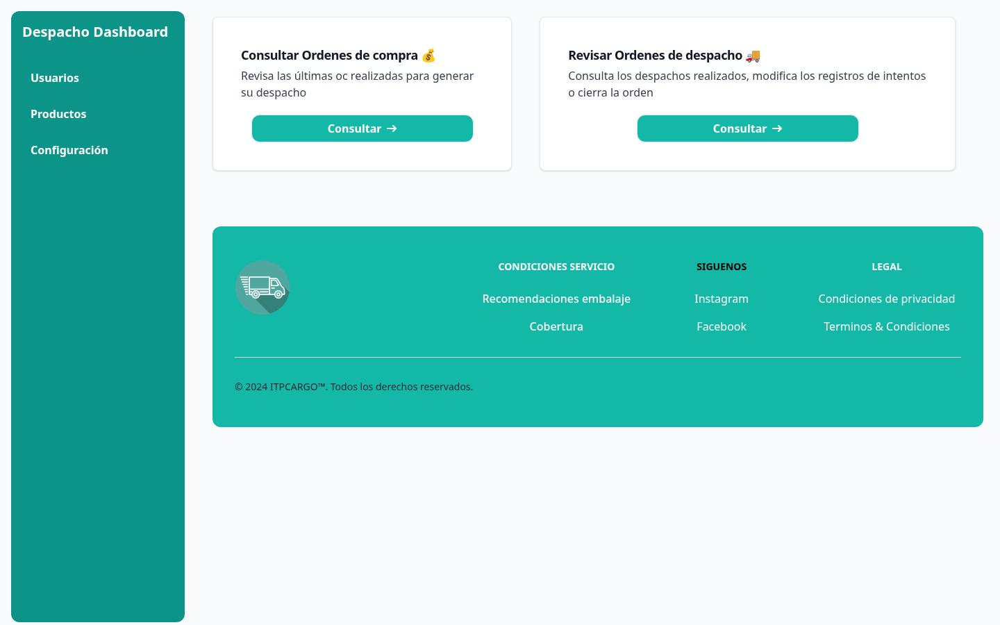
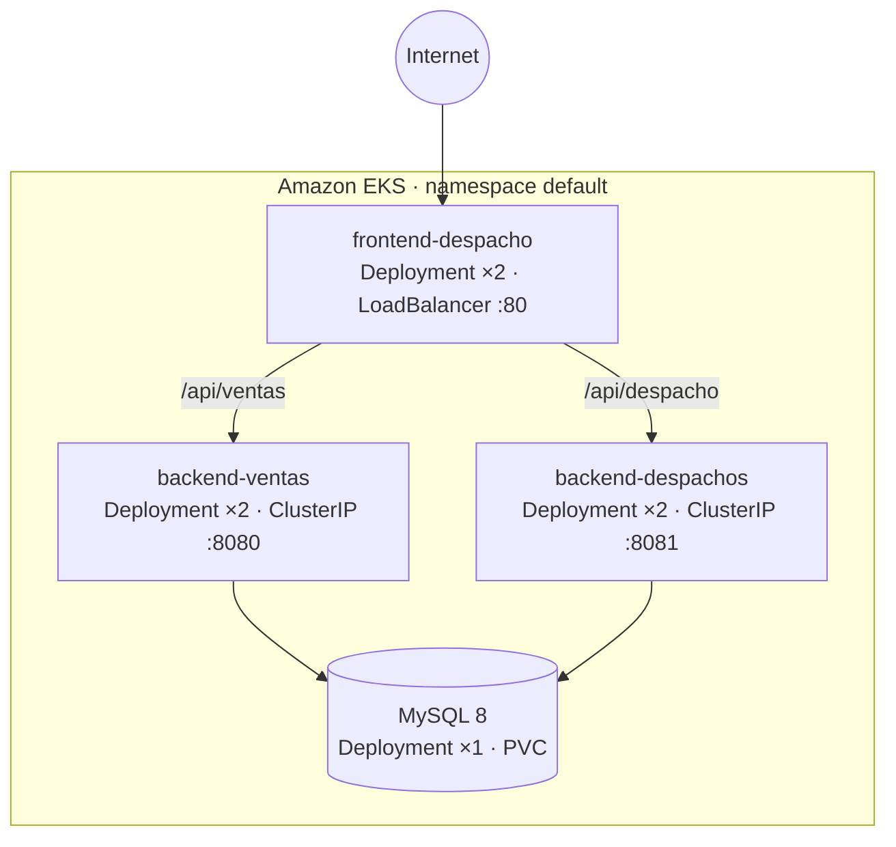

# Innovatech Chile — Microservicios en Amazon EKS

[](https://github.com/emilio-araya/proyecto-innovatech/actions/workflows/ci.yml)
[](https://openjdk.org)
[](https://spring.io/projects/spring-boot)
[](https://react.dev)
[](https://www.docker.com)
[](https://aws.amazon.com/eks)
[](https://www.terraform.io)
[](LICENSE)

Tienda con dos APIs Spring Boot (ventas y despachos) y un frontend React. Las tres aplicaciones se
empaquetan con Docker multi-stage, se publican en Amazon ECR y se despliegan en Amazon EKS, con la
infraestructura definida en Terraform.

Proyecto semestral de la asignatura de DevOps (Duoc UC), desarrollado en equipo. Este repositorio
reúne el trabajo del equipo y las mejoras que mantengo: el pipeline de CI, los Dockerfiles, los
manifiestos de Kubernetes, la integración de las ramas de desarrollo e infraestructura en `main` y
la documentación. El repositorio original del equipo es
[bencasolocaso/proyecto-semestral-devops](https://github.com/bencasolocaso/proyecto-semestral-devops).



> **Estado.** `main` compila y ejecuta los tests de las dos APIs en cada push (badge verde). El
> despliegue a AWS estaba atado a un laboratorio de AWS Academy que ya expiró; el stack completo se
> levanta localmente con Docker Compose.

## Qué hace

| Módulo | Puerto | Función |
|---|---|---|
| API de ventas | `8080` | CRUD de ventas: dirección, valor y fecha de compra |
| API de despachos | `8081` | CRUD de despachos: compra asociada, patente del camión, intentos y estado |
| Frontend | `80` | Dashboard con las vistas de ventas y despachos, servido por nginx |

El frontend consume las APIs a través de rutas relativas `/api/*`; nginx quita el prefijo y reenvía
cada llamada al servicio correspondiente. Así el mismo build funciona en local y en el clúster, sin
URLs compiladas.

## Levantarlo en un comando

```bash
docker compose up --build
```

| Servicio | URL |
|---|---|
| Frontend | <http://localhost> |
| API de ventas | <http://localhost:8080> |
| API de despachos | <http://localhost:8081> |
| MySQL (host) | `localhost:3307` |

Para comprobar que todo está arriba:

```bash
curl http://localhost/api/ventas/api/v1/ventas      # []
curl http://localhost/api/despacho/api/v1/despachos # []
```

Detalles que importan:

- La primera vez tarda unos minutos: compila las dos APIs con Maven y el frontend con Vite. Las
  imágenes son multi-stage, así que el JDK y `node_modules` no viajan a la imagen final.
- MySQL se publica en `3307` para no chocar con un MySQL local en `3306`. Dentro de la red del
  compose los contenedores se hablan por `3306`.
- `docker/mysql-init.sql` crea `ventas_db` y `despachos_db` con permisos para el usuario de
  desarrollo.
- El frontend espera a que las dos APIs estén *healthy*. nginx resuelve los nombres de los
  servicios una sola vez al iniciar; sin esa espera, el primer request devuelve `502`.
- Los servicios tienen alias de red (`backend-ventas-service` y `backend-despachos-service`) con
  los mismos nombres que usa `nginx.conf`, para que el frontend resuelva igual que en Kubernetes.

Bajar el stack y borrar el volumen de MySQL:

```bash
docker compose down -v
```

Las credenciales del compose (`root123`, `despacho_user` / `despacho_pass`) son de desarrollo y no
se usan en el clúster. En Kubernetes el secreto se crea aparte, desde una plantilla.

## API

Las dos APIs exponen el mismo CRUD sobre su recurso:

| Método | Ventas (`:8080`) | Despachos (`:8081`) |
|---|---|---|
| `GET` | `/api/v1/ventas` | `/api/v1/despachos` |
| `GET` | `/api/v1/ventas/{id}` | `/api/v1/despachos/{id}` |
| `POST` | `/api/v1/ventas` | `/api/v1/despachos` |
| `PUT` | `/api/v1/ventas/{id}` | `/api/v1/despachos/{id}` |
| `DELETE` | `/api/v1/ventas/{id}` | `/api/v1/despachos/{id}` |

Crear una venta:

```bash
curl -X POST http://localhost:8080/api/v1/ventas \
  -H "Content-Type: application/json" \
  -d '{
    "direccionCompra": "Av. Siempre Viva 742",
    "valorCompra": 15990,
    "fechaCompra": "2026-10-25",
    "despachoGenerado": false
  }'
```

Respuesta `201 Created`, con el `Location` del recurso:

```json
{
  "idVenta": 1,
  "direccionCompra": "Av. Siempre Viva 742",
  "valorCompra": 15990,
  "fechaCompra": "2026-10-25",
  "despachoGenerado": false
}
```

Documentación interactiva generada con OpenAPI:

- Ventas: <http://localhost:8080/swagger-ui/index.html>
- Despachos: <http://localhost:8081/swagger-ui/index.html>

A través del frontend, la misma llamada es `http://localhost/api/ventas/api/v1/ventas`.

## Tests

La suite incluye un test unitario del servicio de ventas (JUnit 5 + Mockito) y el test de contexto
de cada API, que levanta Spring contra MySQL. El CI corre una matriz por servicio con MySQL 8.4:

```yaml
./mvnw -B verify
```

Para correrlos en local contra el MySQL del compose:

```bash
docker compose up -d mysql-db

cd back-Ventas_SpringBoot/Springboot-API-REST
DB_ENDPOINT=localhost DB_PORT=3307 DB_NAME=ventas_db \
DB_USERNAME=despacho_user DB_PASSWORD=despacho_pass \
./mvnw verify

cd ../../back-Despachos_SpringBoot/Springboot-API-REST-DESPACHO
DB_ENDPOINT=localhost DB_PORT=3307 DB_NAME=despachos_db \
DB_USERNAME=despacho_user DB_PASSWORD=despacho_pass \
./mvnw verify
```

El frontend no tiene tests automatizados; la cobertura de CI se limita a las dos APIs.

## Arquitectura



En el clúster solo el frontend se expone a Internet. Las dos APIs y la base de datos son
`ClusterIP`: se alcanzan únicamente desde dentro del clúster. El `nginx` del frontend hace el
fallback de SPA y reparte las llamadas `/api/*` a cada servicio.

En local, Docker Compose reproduce la misma topología: un único punto de entrada por el puerto 80,
las APIs en la red interna y MySQL con un volumen persistente.

## Stack

| Capa | Tecnología |
|---|---|
| Backend | Java 17 · Spring Boot 3.4 · Spring Data JPA · Bean Validation · Maven |
| Frontend | React 18 · Vite 5 · Tailwind CSS 3 |
| Base de datos | MySQL 8.0 en el clúster, con `PersistentVolumeClaim` |
| Contenedores | Docker multi-stage · nginx |
| Orquestación | Kubernetes (Amazon EKS) · HPA · `LoadBalancer` + `ClusterIP` |
| Infraestructura | Terraform 1.x · AWS provider 5.x · VPC, subredes, EKS, IAM |
| CI/CD | GitHub Actions · Amazon ECR |

## Estructura

```text
.
├── .github/workflows/
│   ├── ci.yml                        Compila las dos APIs y corre sus tests contra MySQL
│   └── workflow.yml                  Build → ECR → EKS al hacer push a la rama deploy
├── back-Ventas_SpringBoot/           API de ventas (:8080)
├── back-Despachos_SpringBoot/        API de despachos (:8081)
├── front_despacho/                   SPA React + nginx con proxies /api
├── docker-compose.yml                Stack completo local: MySQL, APIs y frontend
├── docker/mysql-init.sql             Crea ventas_db y despachos_db al primer arranque
├── .env.example                      Variables de desarrollo
├── k8s/                              Manifiestos: deployments, services, HPA, MySQL y PVC
│   └── examples/                     Plantilla del secreto de base de datos
├── terraform/                        VPC, subredes, EKS, IAM y addons
├── scripts/                          Despliegue de la base y del stack
└── docs/
    ├── kubernetes.md                 Orden de aplicación, secreto y diseño de red
    └── screenshot.png                Captura del dashboard
```

## Correr cada servicio por separado

Las dos APIs leen la conexión por variables de entorno: `DB_ENDPOINT`, `DB_PORT`, `DB_NAME`,
`DB_USERNAME` y `DB_PASSWORD`. Con un MySQL 8 local:

```bash
docker run -d --name innovatech-mysql -p 3306:3306 \
  -e MYSQL_ROOT_PASSWORD=root \
  -e MYSQL_DATABASE=ventas_db \
  mysql:8.0

docker exec innovatech-mysql mysql -uroot -proot -e "CREATE DATABASE despachos_db;"
```

API de ventas:

```bash
cd back-Ventas_SpringBoot/Springboot-API-REST
DB_ENDPOINT=localhost DB_PORT=3306 DB_NAME=ventas_db \
DB_USERNAME=root DB_PASSWORD=root \
./mvnw spring-boot:run
```

API de despachos:

```bash
cd back-Despachos_SpringBoot/Springboot-API-REST-DESPACHO
DB_ENDPOINT=localhost DB_PORT=3306 DB_NAME=despachos_db \
DB_USERNAME=root DB_PASSWORD=root \
./mvnw spring-boot:run
```

Frontend en modo desarrollo:

```bash
cd front_despacho
npm install
npm run dev
```

El proxy de Vite apunta por defecto a una API Gateway del proyecto original. Para trabajar contra
las APIs locales, cambiá el `target` de `/api` en `front_despacho/vite.config.js` a
`http://localhost:8080` o `http://localhost:8081`.

## Infraestructura

[`terraform/`](terraform) crea la VPC, las subredes, el clúster de EKS, los roles de IAM y los
addons. Se configura con `terraform.tfvars`, a partir de
[`terraform.tfvars.example`](terraform/terraform.tfvars.example):

```bash
cd terraform
cp terraform.tfvars.example terraform.tfvars
terraform init
terraform plan
terraform apply
```

El nombre del clúster sale de la variable `cluster_name` (por defecto `innovatech-eks-cluster`).

## Despliegue

**Pipeline.** El workflow [`workflow.yml`](.github/workflows/workflow.yml) se dispara con push a la
rama `deploy`: construye las tres imágenes, las publica en Amazon ECR y aplica los manifiestos al
clúster. Necesita los secrets `AWS_ACCESS_KEY_ID`, `AWS_SECRET_ACCESS_KEY`, `AWS_SESSION_TOKEN` y
`EKS_CLUSTER_NAME`.

**Manual.** El secreto de la base no se versiona; se crea una vez desde la plantilla y después se
aplican los manifiestos:

```bash
cp k8s/examples/db-secret.example.yaml k8s/db-secret.yaml
# completar endpoint, usuario y contraseña
kubectl apply -f k8s/db-secret.yaml

aws eks update-kubeconfig --name innovatech-eks-cluster --region us-east-1
kubectl apply -f k8s/
kubectl get pods,svc
```

Los pasos completos están en [`docs/kubernetes.md`](docs/kubernetes.md).

## Decisiones técnicas

- **Un solo punto de entrada.** En el clúster el `LoadBalancer` vive en el frontend; las APIs y
  MySQL son `ClusterIP`. Menos superficie expuesta y un solo costo de balanceador.
- **Sin credenciales en el repositorio.** El secreto real se crea con `kubectl` y está en
  `.gitignore`; lo único versionado es una plantilla con `REPLACE_ME`.
- **Dos réplicas por aplicación y HPA.** Las APIs y el frontend toleran la caída de un pod y
  escalan con carga; MySQL queda con una réplica y volumen persistente, porque el alcance no
  incluye alta disponibilidad de la base.
- **Imágenes multi-stage.** El build de Maven y el de Vite no viajan a la imagen final: al runtime
  solo pasa el JAR y el `dist/` servido por nginx.
- **Configuración externalizada.** Ninguna URL, usuario ni contraseña está compilada en el código;
  todo entra por variables de entorno.
- **Compose con la misma topología que el clúster.** Alias de red con los nombres de los Services y
  healthchecks en las APIs, para que `docker compose up` funcione de una sola vez y no dependa de
  reiniciar el frontend.

## Mi aporte

- **CI** ([`ci.yml`](.github/workflows/ci.yml)): compila las dos APIs y corre sus tests contra
  MySQL 8 en cada push y pull request, con una matriz por servicio.
- **Docker y Kubernetes**: Dockerfiles multi-stage de las tres aplicaciones y los manifiestos de
  [`k8s/`](k8s) (deployments, services, HPA, MySQL con volumen persistente y plantilla de secreto).
- **Backend**: inyección por constructor, validación de entradas y configuración de la base
  externalizada en las dos APIs.
- **Stack local**: dejé el `docker-compose.yml` funcionando de punta a punta, con una base por API,
  inicialización reproducible de MySQL, alias de red compatibles con nginx y healthchecks.
- **Integración y limpieza**: unifiqué las ramas `deploy` e `infrastructure/terraform` en `main`,
  eliminé el set de manifiestos duplicado y saqué las credenciales de la base del repositorio.
- **Documentación**: este README y [`docs/kubernetes.md`](docs/kubernetes.md).

La infraestructura del clúster con Terraform (VPC, subredes, EKS e IAM) la escribió Luis Villalobos.

## Limitaciones

- **Credenciales temporales.** El clúster se creó en un laboratorio de AWS. Fuera de ese entorno el
  pipeline no puede autenticarse ni encontrar el clúster; por eso el despliegue no corre en cada
  push a `main`.
- **Sin demo pública.** Al expirar el laboratorio, el `LoadBalancer` dejó de responder. La captura
  y el stack local son la forma de ver la aplicación.
- **Sin TLS ni dominio.** El servicio se publica por HTTP, sin certificado.
- **MySQL con una réplica.** El volumen persistente protege los datos, pero no hay alta
  disponibilidad de la base ni failover.
- **El frontend no tiene tests automatizados.** La cobertura de CI se limita a las dos APIs.

## Equipo

Benjamín Serrano · Emilio Araya · Luis Villalobos
