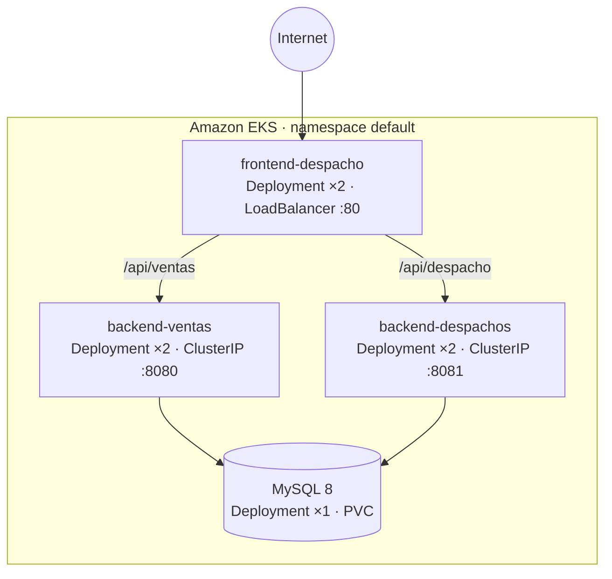

# Innovatech Chile — Microservicios en Amazon EKS

[](https://github.com/emilio-araya/proyecto-innovatech/actions/workflows/ci.yml)
[](https://openjdk.org)
[](https://spring.io/projects/spring-boot)
[](https://react.dev)
[](https://aws.amazon.com/eks)
[](https://www.terraform.io)
[](LICENSE)

Proyecto semestral de la asignatura de DevOps (Duoc UC), desarrollado en equipo. Una tienda con
dos APIs Spring Boot (ventas y despachos) y un frontend React, empaquetados con Docker, publicados
en Amazon ECR y desplegados en Amazon EKS.

El repositorio reúne el trabajo del equipo y las mejoras que mantengo: el pipeline de CI, los
Dockerfiles, los manifiestos de Kubernetes, la integración de las ramas de desarrollo e
infraestructura en `main` y la documentación. El repositorio original del equipo es
[bencasolocaso/proyecto-semestral-devops](https://github.com/bencasolocaso/proyecto-semestral-devops).

## Arquitectura



Solo el frontend se expone a Internet. Las dos APIs y la base de datos son `ClusterIP`: se alcanzan
únicamente desde dentro del clúster. El `nginx` del frontend hace el fallback de SPA que necesita
React Router y reparte las llamadas `/api/*` a cada servicio.

## Stack

| Capa | Tecnología |
|---|---|
| Backend | Java 17 · Spring Boot 3.4 · Spring Data JPA · Maven |
| Frontend | React 18 · Vite 5 · Tailwind CSS 3 |
| Base de datos | MySQL 8.0 en el clúster, con `PersistentVolumeClaim` |
| Contenedores | Docker multi-stage · nginx |
| Orquestación | Kubernetes (Amazon EKS) · HPA · `LoadBalancer` + `ClusterIP` |
| Infraestructura | Terraform 1.x · AWS provider 5.x · VPC, subredes, EKS, IAM |
| CI/CD | GitHub Actions · Amazon ECR |

## Estructura

```text
.
├── .github/workflows/
│   ├── ci.yml                        Compila las dos APIs y corre sus tests contra MySQL
│   └── workflow.yml                  Build → ECR → EKS al hacer push a la rama deploy
├── back-Ventas_SpringBoot/           API de ventas (:8080)
├── back-Despachos_SpringBoot/        API de despachos (:8081)
├── front_despacho/                   SPA React + nginx con proxies /api
├── k8s/                              Manifiestos: deployments, services, HPA, MySQL y PVC
│   └── examples/                     Plantilla del secreto de base de datos
├── terraform/                        VPC, subredes, EKS, IAM y addons
├── scripts/                          Despliegue de la base y del stack
└── docs/kubernetes.md                Orden de aplicación, secreto y diseño de red
```

## Cómo correr en local

Las dos APIs leen la conexión por variables de entorno: `DB_ENDPOINT`, `DB_PORT`, `DB_NAME`,
`DB_USERNAME` y `DB_PASSWORD`. Alcanza con un MySQL 8 local:

```bash
docker run -d --name innovatech-mysql -p 3306:3306 \
  -e MYSQL_ROOT_PASSWORD=root \
  -e MYSQL_DATABASE=ventas_db \
  mysql:8.0

docker exec innovatech-mysql mysql -uroot -proot -e "CREATE DATABASE despachos_db;"
```

API de ventas (puerto 8080):

```bash
cd back-Ventas_SpringBoot/Springboot-API-REST
DB_ENDPOINT=localhost DB_PORT=3306 DB_NAME=ventas_db \
DB_USERNAME=root DB_PASSWORD=root \
./mvnw spring-boot:run
```

API de despachos (puerto 8081):

```bash
cd back-Despachos_SpringBoot/Springboot-API-REST-DESPACHO
DB_ENDPOINT=localhost DB_PORT=3306 DB_NAME=despachos_db \
DB_USERNAME=root DB_PASSWORD=root \
./mvnw spring-boot:run
```

Frontend (puerto 5173):

```bash
cd front_despacho
npm install
npm run dev
```

El proxy de desarrollo de Vite apunta a una API Gateway del proyecto original. Para trabajar contra
las APIs locales, cambiá el `target` de `/api` en `front_despacho/vite.config.js` a
`http://localhost:8080` o `http://localhost:8081`.

## Infraestructura

[`terraform/`](terraform) crea la VPC, las subredes, el clúster de EKS, los roles de IAM y los
addons. Se configura con `terraform.tfvars`, a partir de
[`terraform.tfvars.example`](terraform/terraform.tfvars.example):

```bash
cd terraform
cp terraform.tfvars.example terraform.tfvars
terraform init
terraform plan
terraform apply
```

El nombre del clúster sale de la variable `cluster_name` (por defecto `innovatech-eks-cluster`).

## Despliegue

**Pipeline.** El workflow [`workflow.yml`](.github/workflows/workflow.yml) se dispara con push a la
rama `deploy`: construye las tres imágenes, las publica en Amazon ECR y aplica los manifiestos al
clúster. Necesita los secrets `AWS_ACCESS_KEY_ID`, `AWS_SECRET_ACCESS_KEY`, `AWS_SESSION_TOKEN` y
`EKS_CLUSTER_NAME`.

**Manual.** El secreto de la base no se versiona; se crea una vez desde la plantilla y después se
aplican los manifiestos:

```bash
cp k8s/examples/db-secret.example.yaml k8s/db-secret.yaml
# completar endpoint, usuario y contraseña
kubectl apply -f k8s/db-secret.yaml

aws eks update-kubeconfig --name innovatech-eks-cluster --region us-east-1
kubectl apply -f k8s/
kubectl get pods,svc
```

Los pasos completos están en [`docs/kubernetes.md`](docs/kubernetes.md).

## Decisiones técnicas

- **Un solo punto de entrada.** El `LoadBalancer` vive en el frontend; las APIs y MySQL son
  `ClusterIP`. Menos superficie expuesta y un solo costo de balanceador.
- **Sin credenciales en el repositorio.** El secreto real se crea con `kubectl` y está en
  `.gitignore`; lo único versionado es una plantilla con `REPLACE_ME`.
- **Dos réplicas por aplicación y HPA.** Las APIs y el frontend toleran la caída de un pod y
  escalan con carga; MySQL queda con una réplica y volumen persistente, porque el alcance no
  incluye alta disponibilidad de la base.
- **Imágenes multi-stage.** El build de Maven y el de Vite no viajan a la imagen final: al runtime
  solo pasa el JAR y el `dist/` servido por nginx.
- **Configuración externalizada.** Ninguna URL, usuario ni contraseña está compilada en el código;
  todo entra por variables de entorno.

## Mi aporte

- **CI** ([`ci.yml`](.github/workflows/ci.yml)): compila las dos APIs y corre sus tests contra
  MySQL 8 en cada push y pull request, con una matriz por servicio.
- **Docker y Kubernetes**: Dockerfiles multi-stage de las tres aplicaciones y los manifiestos de
  [`k8s/`](k8s) (deployments, services, HPA, MySQL con volumen persistente y plantilla de secreto).
- **Backend**: inyección por constructor, validación de entradas y configuración de la base
  externalizada en las dos APIs.
- **Integración y limpieza**: unifiqué las ramas `deploy` e `infrastructure/terraform` en `main`,
  eliminé el set de manifiestos duplicado y saqué las credenciales de la base del repositorio.
- **Documentación**: este README y [`docs/kubernetes.md`](docs/kubernetes.md).

La infraestructura del clúster con Terraform (VPC, subredes, EKS e IAM) la escribió Luis Villalobos.

## Limitaciones

- **Credenciales temporales.** El clúster se creó en un laboratorio de AWS. Fuera de ese entorno el
  pipeline no puede autenticarse ni encontrar el clúster; por eso el despliegue no corre en cada
  push a `main`.
- **Sin TLS ni dominio.** El servicio se publica por HTTP, sin certificado.
- **MySQL con una réplica.** El volumen persistente protege los datos, pero no hay alta
  disponibilidad de la base ni failover.
- **El frontend no tiene tests automatizados.** La cobertura de CI se limita a las dos APIs.

## Equipo

Benjamín Serrano · Emilio Araya · Luis Villalobos
